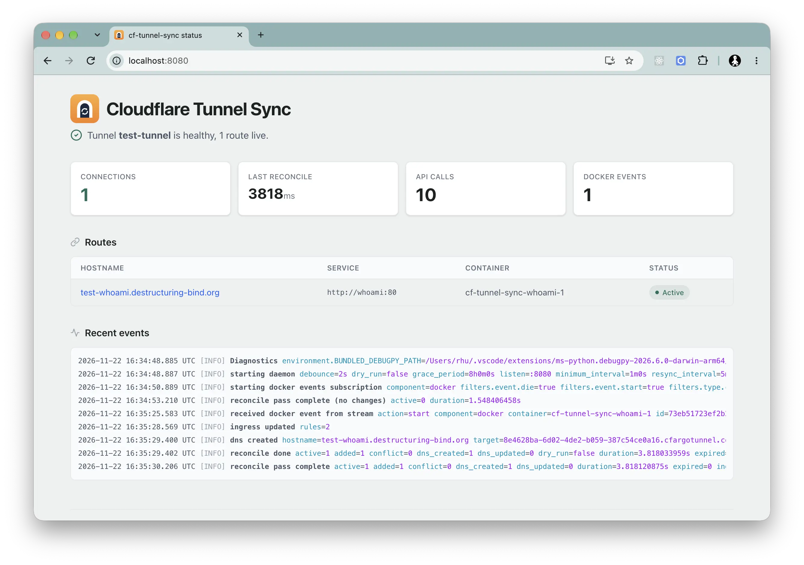

# cf-tunnel-sync

A Go daemon that keeps a Cloudflare Tunnel's ingress rules and DNS records in sync with Docker container labels. It is a clean-room minimal/lightweight re-implementation of [DockFlare](https://github.com/ChrispyBacon-dev/DockFlare  ), without the Redis/email/auth/multi-container "feature expansion".

It watches Docker containers for labels (`cloudflare.tunnel.*` or `dockflare.*`), derives ingress rules from them, and reconciles the remote tunnel configuration and DNS records to match. Anything in the tunnel that is not produced by a label is removed.

Includes a read-only HTTP status page for monitoring and a [prometheus metrics](https://prometheus.io/docs/introduction/overview/) endpoint.



## Quick Start

```bash
# 1. Clone and configure
git clone https://github.com/rm-hull/cf-tunnel-sync.git
cd cf-tunnel-sync
cp config.example.yaml config.yaml

# 2. Set environment variables
export CF_API_TOKEN="your-token"
export CF_ACCOUNT_ID="your-account-id"

# 3. Start with Docker Compose
docker compose up -d
```

## Configuration

Configuration is via `config.yaml` and Docker labels only — no web UI, no auth.

See [`config.example.yaml`](config.example.yaml) for a complete example and [`docs/RUNBOOK.md`](docs/RUNBOOK.md) for operational details.

## Key Features

- **Label-driven**: tunnel config is derived solely from Docker container labels.
- **DockFlare compatible**: supports both `cloudflare.tunnel.*` and `dockflare.*` label prefixes.
- **Grace-period removal**: DNS records are kept for a configurable period after a rule disappears.
- **Dry run mode**: preview changes before applying them.
- **Status page**: read-only HTML + JSON endpoints for monitoring.
- **Structured logging**: JSON logs with request-level detail.

## Documentation

- [Runbook](docs/RUNBOOK.md) — setup, troubleshooting, and operational guidance
- [Migration guide](docs/MIGRATION.md) — migrating from DockFlare v2.1.7
- [Implementation plan](docs/PLAN.md) — architecture and design decisions

## License

[MIT](LICENSE.md)